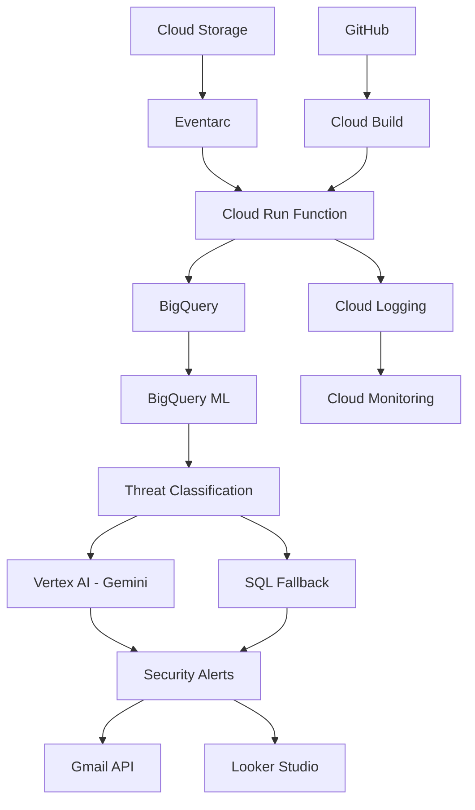

# CloudSentinel AI

### AI-Powered Cyber Threat Intelligence & Automated Cloud Data Pipeline

CloudSentinel AI is a cloud-native cybersecurity project built on Google Cloud Platform (GCP). It integrates event-driven architecture, automated data engineering, machine learning, generative AI, and CI/CD to detect potential network threats and deliver actionable security recommendations.

## Project Objectives

- Automate network security data ingestion and processing.
- Detect potential cyber threats using machine learning.
- Generate AI-powered security recommendations.
- Automate security notifications and reporting.
- Implement cloud-native infrastructure and CI/CD automation.

## System Architecture



## Technology Stack

| Category | Technologies |
|---|---|
| Cloud Platform | Google Cloud Platform |
| DevOps & CI/CD | GitHub, Cloud Build |
| Serverless Computing | Cloud Run Functions |
| Event-Driven Architecture | Eventarc |
| Data Storage | Cloud Storage, BigQuery |
| Data Engineering | Python, SQL, ELT |
| Machine Learning | BigQuery ML |
| Generative AI | Vertex AI, Gemini |
| Visualization | Looker Studio |
| Notifications | Gmail API |
| Observability | Cloud Monitoring, Cloud Logging |
| Security | IAM, Secret Manager |

## Key Features

- Event-driven CSV ingestion.
- Automated schema and data validation.
- Duplicate prevention using deterministic identifiers and SQL MERGE.
- Machine learning-based threat prediction.
- Automated risk classification.
- Structured AI-generated security recommendations.
- Rule-based SQL fallback.
- Automated HTML email security reports.
- Interactive security dashboards.
- Automated build and deployment pipeline.

## Threat Risk Classification

| Risk Level | Attack Probability |
|---|---|
| Critical | 90% and above |
| High | 75% to below 90% |
| Medium | 50% to below 75% |
| Low | Below 50% |

## CI/CD Pipeline

The Cloud Build pipeline automates:

1. Python dependency installation.
2. Python syntax validation.
3. Cloud Run function deployment.
4. Build and deployment logging.

## Security and Reliability

- Environment-based credential management.
- Parameterized BigQuery queries.
- Input validation and file size restrictions.
- Deterministic record identifiers.
- BigQuery job retry handling.
- AI request limits and fallback mechanisms.
- Human verification before containment actions.

## Repository Structure

```text
CloudSentinel-AI/
├── main.py
├── cloudbuild.yaml
├── requirements.txt
├── .gitignore
└── README.md
```

## Limitations

CloudSentinel AI is an educational proof of concept.
Machine learning predictions do not represent confirmed cyber attacks.
AI-generated recommendations require human verification before implementation.

## Project Background

Developed as a capstone project for the Data Engineering with Google Cloud Bootcamp at Tuwaiq Academy.

November 2026

## Author

Shouq Majed Al-Subaie

DevOps & Cloud Engineering

[LinkedIn](https://www.linkedin.com/in/shouqalsubaie)
